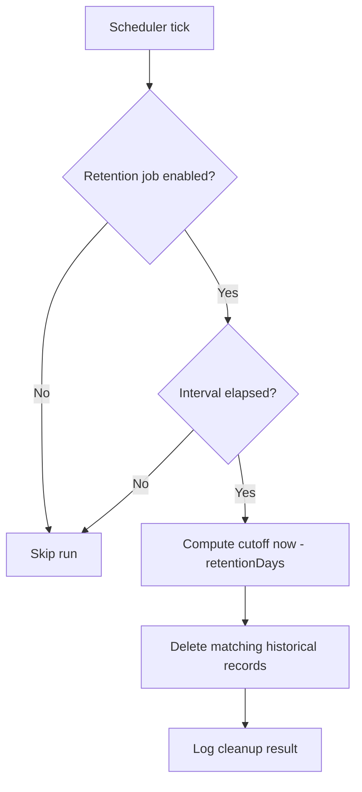

# Configuration: Check Scheduling

This page describes how check intervals and parallelism work.

## Resource Type Defaults

| Resource Type | Default Interval | Default Parallelism |
|---------------|------------------|---------------------|
| HTTP | 1 minute | 5 threads |
| DOCKER | 5 minutes | 2 threads |
| TCP | 1 minute | 5 threads |

Settings are managed in **Admin -> Resource Types**.

## Resource Discovery Defaults

| Discovery Service Type | Default Sync Interval | Default Parallelism |
|------------------------|-----------------------|---------------------|
| DOCKER_REPOSITORY | 60 minutes | 1 thread |
| OPENSHIFT_ROUTE | 60 minutes | 1 thread |
| LITELLM | 5 minutes | 1 thread |

Settings are managed in **Admin -> Resource Discovery**.

## How Scheduler Timing Works

- The scheduler loop runs every 30 seconds.
- A resource type run is dispatched when `now - lastRun >= interval`.
- Parallelism controls concurrent checks for that type.

## Startup Behavior

Kairos always performs an immediate check pass at startup, independent of configured intervals.

## Outage Detection and Recovery

Outages are evaluated per resource type and configured in **Admin -> Resource Types**.

| Setting | Default | Meaning |
|---------|---------|---------|
| Outage threshold | `3` | Open an outage after this many consecutive `NOT_AVAILABLE` check results |
| Recovery threshold | `2` | Close an active outage after this many consecutive `AVAILABLE` check results |

Outage lifecycle:

- At most one active outage is kept per resource.
- Outage start time is based on the first failing check in the triggering failure streak.
- Outage end time is set to the check time that satisfies the recovery threshold.

Operational notes:

- Public outage overview page: `/outages`
- Resource detail pages include active outage banner and outage history table
- Dashboard rows/cards show active outage indicators with live elapsed time

## Retention Jobs

Kairos runs retention in dedicated background jobs. Both jobs are configured in **Admin -> General Settings** and run independently from check execution.

### Check History Retention

- Controls: `checkHistoryRetentionEnabled`, `checkHistoryRetentionIntervalMinutes`, `checkHistoryRetentionDays`
- Default interval: 60 minutes
- Default retention: 31 days
- Deletion reference: `check_result.checked_at`

### Outage Retention

- Controls: `outageRetentionEnabled`, `outageRetentionIntervalHours`, `outageRetentionDays`
- Default interval: 12 hours
- Default retention: 31 days
- Deletion reference: `outage.endDate`
- Only closed outages are removed; active outages are never deleted by retention.

### Retention Flow



### Safety Notes

- Set retention values according to compliance and incident review requirements.
- Outage retention uses end date to preserve full incident duration before deletion.
- If you need long-term analytics, export data before lowering retention days.

## DOCKER_REPOSITORY Discovery Behavior

`DOCKER_REPOSITORY` sync runs do not create direct check entries.

Instead, each run synchronizes discovered images into generated `DOCKER` resources in an auto-created group and removes resources that no longer exist in the upstream registry.

For Artifactory Docker remotes, Kairos first tries Docker Registry v2 catalog endpoints. If an Artifactory catalog is empty, Kairos falls back to the Artifactory storage listing API and discovers repositories from tagged `manifest.json` entries before reading tags through the registry API.

## OPENSHIFT_ROUTE Discovery Behavior

`OPENSHIFT_ROUTE` sync queries the OpenShift API to discover routes across all accessible projects and automatically creates, updates, or removes generated `HTTP` resources in Kairos.

Each discovered route results in an `HTTP` resource named `{project}/{route}` grouped under `{discoveryServiceName}/{project}`.

### Selective Scraping via Annotations

By default, all discoverable routes are imported. You can restrict discovery to only routes that are explicitly opted in by enabling **Only scrape tagged resources** on the discovery service configuration.

When this option is enabled, only routes carrying the annotation `kairos.wenisch.tech/scrape: "true"` are imported. Routes without this annotation are silently skipped.

To tag a route for discovery:

```bash
oc annotate route <route-name> -n <namespace> kairos.wenisch.tech/scrape=true
```

To remove a route from discovery:

```bash
oc annotate route <route-name> -n <namespace> kairos.wenisch.tech/scrape-
```

> Routes that are removed from the tag set (or have the annotation removed) will be deleted from Kairos on the next discovery sync, following the same lifecycle as any other route that disappears from the cluster.

| Option | Default | Behavior |
|--------|---------|----------|
| Only scrape tagged resources | disabled | All routes are imported |
| Only scrape tagged resources | enabled | Only routes with `kairos.wenisch.tech/scrape: "true"` are imported |

## LITELLM Discovery Behavior

`LITELLM` discovery turns a [LiteLLM](https://docs.litellm.ai/) proxy into a group of monitored models.

1. Add a discovery service of type `LITELLM` under **Admin -> Resource Discovery**. The target is the proxy base URL, for example `https://litellm.example.com`.
2. Add a **Bearer** credential in the same page whose URL pattern matches the target (for example `https://litellm.example.com*`). The token goes into the password field.
3. On every sync Kairos calls `GET {url}/health` and creates one `LITELLM_MODEL` resource per model listed in `healthy_endpoints` and `unhealthy_endpoints`, grouped under the discovery service name.

Each sync also records a check result per model (`healthy_endpoints` -> available, `unhealthy_endpoints` -> not available, with LiteLLM's error as message), so history, uptime, outages and notifications work like for any other resource. If the proxy itself cannot be reached or rejects the token, all of its models are recorded as not available. Models that disappear from the health report are removed.

Notes:

- `/health` makes a live request to every configured model, so keep the sync interval reasonable (default 5 minutes; the request timeout is 120 seconds).
- Models served by several deployments with the same name are listed as `model (api_base)`.
- `LITELLM_MODEL` resources are managed by discovery only and cannot be added manually.
